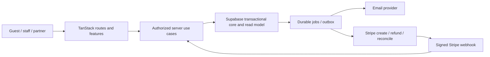

# Fifthwheel MVP — Technical Design and Architecture

Version 3 · 2026-11-11 · Fresh-rewrite design contracts; no implementation or deployed behavior is claimed. [PRD](PRD.md) is the product authority.

[PRD](PRD.md) owns policy R00–R11 and decisions D01–D18. [Backlog](tasks-checklist.md) owns sequence/checks. All paths below are relative to `app/` unless explicitly prefixed with repository root.

## 1. Current implementation and target boundaries

The previous app is archived under `archives/app-2026-11-11-before-restart/`. It is a visual/reference source, not the runtime or an implementation to patch. Create a fresh application entry, route tree, layouts, feature modules and tests. No imports of archived application code, prototype UI or historical migration runner are allowed. Reimplement the product contracts; extract documented visual tokens/assets without inheriting prototype state or old payment/refund copy.

React/TypeScript, TanStack Start/Vite, Supabase, Stripe and email remain the documented technical defaults. Recreate framework entry/configuration from supported conventions rather than preserving old route files. Verify pinned installed versions at implementation time. No framework or provider changes are authorized by the visual/IA clarification alone. Use routes for URLs/loaders, features for pages/forms, domain for pure rules, authorized server services and provider adapters, and shared layout/UI components.

Fresh local schema and fixtures must be isolated. A fresh codebase does not authorize resetting hosted data or blindly applying historical migrations. Inventory and reconcile live records before designing the eventual additive migration/cutover. All external writes remain separately authorized.



No UI component is a source of identity, price, paid status or permissions. No app API accepts a caller-selected Stripe environment in production.

## 2. Source ownership

| Data                                                                                                                                        | Authority              | Rules                                                                                                                              |
| ------------------------------------------------------------------------------------------------------------------------------------------- | ---------------------- | ---------------------------------------------------------------------------------------------------------------------------------- |
| Supply title, local scheduled date/time, neighborhood, venue itinerary, host-facing supply notes, publication intent                        | Supabase               | Admins curate Venues and Tables in the app (draft → approve → publish revisions). Private notes are never published.               |
| Table runtime state, approval version, roster, holds, paid count, operational cancellation/proceed                                          | Supabase               | Supply revisions never set runtime cancellation/completion/paid state.                                                             |
| Guest/contact/DOB, identity checks, requests, waitlist claim, offers, Seats, money ledger, attendance, vote, feedback, reports, roles/audit | Supabase               | UUID ownership; no runtime writes to legacy Airtable guest/booking tables after cutover.                                           |
| Charges and refund settlement                                                                                                               | Stripe                 | Supabase stores verified ledger, obligations and reconciliation state. Stripe success cannot be inferred from client URL.          |

### Supply curation contract

- Admins curate supply in the app; Supabase is the only source of truth. There is no external supply provider or sync.
- `app_supply_venues` holds name, address, neighborhood and an `active` flag. Venues are archived, never deleted, because published revisions reference their ids. Only active venues can be chosen for a stop.
- A Table is a head plus immutable revisions (draft → accepted → published). Each stop snapshots the venue name and address, so later venue edits never rewrite a published Table.
- Store the local date and strict `HH:mm` start time in `America/New_York`; convert to UTC `timestamptz` for every window comparison. Reject nonexistent or ambiguous local times for explicit staff correction.
- Require title/date/time/neighborhood and three ordered stops (drinks → dinner → dessert, default offsets 0/+45m/+120m) before acceptance. A venue may repeat across stops.
- Every create/update/accept/publish and weekly clone carries a client-generated operation UUID; a retry with the same body replays the stored result and a different body is an `operation_conflict`.
- Approval captures the accepted `supply_revision`. After activity (invitation, paid Seat, proceed), schedule and venue edits are refused as `protected_change`; cosmetic corrections may still be saved. No rescheduling; cancel and create a new Table for a changed night.

## 3. Core schema contract

UUID primary keys, UTC created/updated timestamps and foreign keys on all entities. Currency integer cents. Preserve source IDs in mapping, not guest URLs. Enum/check/unique constraints enforce the following logical schema; actual migration names generated using installed CLI conventions.

| Record                                                                  | Minimum fields and invariant                                                                                                                                                                                                                                                                                        |
| ----------------------------------------------------------------------- | ------------------------------------------------------------------------------------------------------------------------------------------------------------------------------------------------------------------------------------------------------------------------------------------------------------------- |
| `guests`                                                                | `id`, nullable unique `auth_user_id`, normalized verified email linkage, name, DOB (nullable only during migration), identity enum woman/man/non_binary (one required), open_to non-empty unique set of woman/man/non_binary, match_min/max ≥21, profile_version, identity_status. Never authorize by client email/phone. |
| `identity_reviews`, `guest_files`                                       | Guest/version, reviewer UUID, decision/reason, owner-scoped private object path, kind photo/selfie, scan/state, timestamps. Approval covers a specific profile version.                                                                                                                                             |
| `waitlist_signups`                                                      | Normalized unique email; all existing marketing intake fields with exact preference selections, source, server receipt time and nullable verified guest linkage. Signup grants no app access or Seat. An unauthenticated repeat cannot overwrite admitted data.                                                                                                                                                                    |
| `app_admissions`, `app_invitation_deliveries` | One admission per normalized waitlist recipient; approving admin/time; nullable unique verified auth user; invited/activated times. Admission has no scheduled expiry or administrative suspension in this MVP. Account deletion ends that account’s sign-in authority; a new magic-link request cannot resurrect a deleted account/admission. Separate send attempts record operation key, provider reference, sending/accepted/failed/unknown and delivery-if-known. Never reuse the Table invitation entity for admission. |
| `tables`, `venues`, `table_stops`                                       | UUID/external mapping, accepted supply revision, scheduled UTC start and zone, ordered public itinerary; runtime state draft/published/review_required/proceeding/cancelled/completed; five-seat capacity.                                                                                                          |
| `table_assignments`, `venue_memberships`                                | Explicit staff user UUID→Table and restaurant user UUID→venue; replace free-text venue authorization.                                                                                                                                                                                                               |
| `applications`                                                          | Guest/Table unique, state requested/withdrawn/declined/selected; request time and safe decision text. Reapplication reopens same record with history when Table is accepting.                                                                                                                                       |
| `roster_revisions`, `roster_members`                                    | Table/version, approval actor, supply/profile-rule versions, validation result; active members ≤5 and unique guest/Table; active invitation/Seat maps to one roster member.                                                                                                                                         |
| `invitations`                                                           | UUID, roster member, guest, sent/converted/revoked/closed state, send time; no expiry. One active invitation per guest/Table. Token is hashed, random, single-claim locator; signed-in owner still required.                                                                                                        |
| `checkout_attempts`                                                     | Guest/Table/invitation/revision, hold deadline, allocation state held/released/consumed/expired, Stripe session unique per mode, operation UUID, session_creation_state, expected 2500 USD cents. Unique live attempt per guest/Table.                                                                              |
| `seats`                                                                 | Guest/Table, roster member, payment ref, confirmed/cancellation_requested/cancelled/completed status; partial unique active Seat guest/Table.                                                                                                                                                                       |
| `payments`, `refund_operations`                                         | Stripe mode+payment/session/refund IDs unique; verified paid amount, currency, guest/Table; refund obligation amount/status pending/submitted/succeeded/failed/unknown with durable operation UUID.                                                                                                                 |
| `cancellation_requests`                                                 | Seat, requester/reviewer, requested/approved/denied, decision refund cents/reason; at most one pending request.                                                                                                                                                                                                     |
| `attendance`, `vote_periods`, `ballot_eligibility`, `ballots`           | Guest/Table unique attendance timestamps/actor; period open/close from start; frozen eligibility; ballot unique voter/Table, nullable chosen eligible guest (Nobody), immutable submitted_at. Disallow self-choice/cross-Table subject.                                                                             |
| `mutual_results`                                                        | Private unique guest/Table row, nullable counterpart Guest ID, finalized_at, expires_at=start+90 days, invalidated_at. No contact data or raw vote attached; owner-only narrow reveal DTO.                                                                                                                          |
| `ratings`, `conduct_reports`                                            | One rating guest/Table with overall 1–5, optional per-stop 1–5, note≤2000; separate report UUID, author/Table/optional attendee subject, body≤4000, triage new/reviewing/resolved.                                                                                                                                  |
| `outbox`, `job_runs`, `stripe_events`, `sync_runs`, `core_audit_events` | Stable dedupe keys, retry/lease state and errors; audit actor/action/entity IDs/outcome/correlation; no sensitive bodies. Stripe inbox tracks event ID+mode unique and processing status.                                                                                                                           |

The pre-existing `public.audit_events` table stores legacy payload and search fields. The MVP migration retains those rows but revokes direct client reads; new redacted operational audit records use `core_audit_events` until a separately reviewed legacy-data migration is approved.

**Shared paid-participant predicate:** `active_paid` means a verified paid Seat whose status is confirmed, cancellation_requested or completed, and which has not been removed/cancelled. A pending cancellation remains included in paid counts, occupied capacity, check-in, ballot eligibility and reveal. Completed retains historical attendance/feedback rights; Table lifecycle and time gates still prevent new checkout/check-in on a completed night. Only approved removal/cancellation ends membership, not the request or refund-provider delay. All uses of “confirmed paid” below use this predicate.

**D16 preference normalization supersedes historical D13:** own identity is one of `woman`, `man`, `non_binary`; open-to is a non-empty deduplicated set of those values. Exact marketing labels Women/Men/Non-binary people map to woman/man/non_binary respectively; comma-separated current intake values are parsed as known complete labels, never substring-guessed. A historical explicit Everyone maps to all three; Women+Men maps to those two only. Preserve original source values in restricted migration evidence. Reject/quarantine unknown values for correction. Every supported combination remains selectable in onboarding and edits. Mutual openness checks each guest’s identity against the other’s set.

**App admission authorization:** validate the provider session server-side and require verified email plus a matching durable admission for member operations. Bind an unambiguous recipient once; never authorize using client-supplied email or user-editable metadata. Admin/host/venue roles remain independently assigned trusted records. Admin admission/send is authorized and persisted with operation ID before dispatch. Outbox retries change delivery, not membership approval or Table/payment state. Returning member-link request uses the same admission gate, generic response, cooldown/rate limit and safe return allowlist. Separately provisioned staff/venue identities can sign in through their role workspace without inventing member admission; role access never implies a guest profile or paid Seat. Token TTL, one-time use, callback validation and cross-device recovery are verified with the selected provider. First login atomically records activation; subsequent links reuse it.

**Marketing intake:** preserve `POST /api/waitlist` and the existing JSON field names in `src/scripts/waitlist.ts`. Bound body size and validate all fields server-side, including calendar DOB/Atlanta 21+ and matching-age ranges from 21 through 120 inclusive. Allow only configured marketing origins for browser CORS; CORS is not abuse protection. Handle honeypot and duplicates neutrally, rate-limit without storing raw IPs in general logs, and return the same neutral 2xx semantics for valid new, duplicate and honeypot submissions (persisting a valid signup once and never overwriting it). The marketing page uses the same success copy for every 2xx; it must not claim list admission or email delivery. Errors have safe validation/retry messages. No privileged key or intake PII appears in the browser bundle, audit payload or normal error logs.

Use transactions for multi-row invariants. Take the Table row lock first, then guest rows in UUID order, then attempt/Seat/payment rows in fixed UUID order. Profile edits lock the same guest rows and invalidate affected roster versions. Monetary operations serialize on payment row. Direct client writes to roster, holds, Seats, money, roles, identity decisions, eligibility or ballots are denied. Public API exposes narrowly shaped server DTOs rather than table dumps.

## 4. State machines and authorization

| Action                     | Actor                                              | Preconditions → commit                                                                                              | Conflict/recovery                                                                         |
| -------------------------- | -------------------------------------------------- | ------------------------------------------------------------------------------------------------------------------- | ----------------------------------------------------------------------------------------- |
| Invite into app / resend | Admin only | Existing waitlist recipient → durable app admission + logical delivery; retry is delivery-only | Duplicate operation is reused; uncertain provider outcome is reconciled; no Table action. |
| Request sign-in / activate | Admitted verified recipient | Fresh expiring magic link → session + existing admission; first activation once | Uninvited response neutral; wrong-owner/used/expired link has safe recovery. |
| Save/submit profile        | Verified owner                                     | Valid profile/files; critical field edit → identity pending and future roster revalidation                          | Save draft on validation failure; stale version returns conflict.                         |
| Review identity            | Admin                                              | Current submitted version + private files → approved/resubmit and safe guest notice                                 | Old version cannot be approved. Assigned host never reads selfie.                         |
| Request/withdraw Seat      | Verified approved guest owner                      | Published future Table, accepting requests → unique application                                                     | No price/seat promise. Repeated same request reuses row.                                  |
| Propose/approve roster     | Assigned host proposes; admin approves             | 3–5 current valid guests + supply/profile versions → approved revision, invitations and outbox                      | Lock/revalidate; invalid sends none. Same action key returns prior result.                |
| Begin/abandon checkout     | Named invitation owner                             | Open offer, identity approved, unchanged valid roster, allowed runtime state, before start → attempt/30m allocation | Reject full/stale/closed. Repeat returns current attempt; no new deadline extension.      |
| Fulfill paid session       | Signed Stripe event or trusted return verification | Server verifies mode/amount/currency/metadata/session; lock Table → payment + Seat or full-refund obligation        | Idempotent verified payment; no duplicate Seat. See §5.                                   |
| Request cancellation       | Seat owner                                         | Confirmed active Seat → cancellation_requested, still occupying capacity                                            | One request; no immediate refund.                                                         |
| Review cancellation/remove | Admin                                              | Current Seat + refund decision → Seat cancelled, offer revoked, hold release, obligation if >0, validity review     | Does not wait for Stripe to release Seat; failed refund remains owed.                     |
| Proceed/cancel Table       | Admin                                              | At/after T−24h valid paid roster 3–5 → proceeding; otherwise cancel required                                        | Invalid proceeding suspended; never auto-cancel. Late charge on cancelled Table refunded. |
| Check in                   | Admin or assigned host                             | Confirmed paid Seat on proceeding Table → attendance timestamp                                                      | Guest cannot self-authorize. At/after vote open no new ballot eligibility.                |
| Submit ballot              | Eligible owner                                     | DB time within window, proceeding Table, active paid Seat → immutable private ballot                                | Same submission replay succeeds; changed choice conflicts; no one-sided response.         |
| Read reveal                | Eligible owner                                     | DB time≥close, own eligibility active → only own mutual match/null                                                  | Cancelled/invalidated guest cannot be exposed as match.                                   |
| Rate/report                | Attended owner                                     | DB time≥vote close → own rating/report                                                                              | Separate admin-only report read/triage; no venue access.                                  |
| Partner read               | Assigned restaurant member                         | UUID venue membership → service DTO                                                                                 | Counts/times/host business contact only; no guest list or private notes.                  |

Initial roster approval can occur before T−24h while no one has paid; a later paid subset might fail viability. At T−24h pause new/continued checkout until staff records a valid proceed decision; below-three must cancel rather than use new payment to rescue it. Before T−24h, a removed member invalidates the approved roster, pauses checkout and requires fresh valid revision. Existing Seats stay recorded; reapproval never charges or re-invites already paid guests. After proceed, revalidation of paid subset and proposed replacement is required; if existing group becomes invalid, suspend proceeding, alert admin and do not open voting until resolved or cancelled.

Replacement: select one approved eligible waitlisted guest or active Table applicant, oldest application/signup time then UUID, validate the resultant 3–5 active roster; no eligible suggestion returns null. Admin removal commits regardless of Yes/No. Yes atomically revokes original invitation, releases hold, increments roster revision and enqueues replacement only if current result validates. Stale/invalid suggestion commits removal without invitation and explains recovery via roster review. No guest removal should be retried just because replacement failed.

## 5. Transactional checkout and money contract

1. Under Table lock: validate invitation ownership, identity/profile/supply revisions and runtime state; expire old holds; enforce `active paid Seats + live held attempts ≤5`; create/reuse 30-minute attempt. A named roster slot limits who may pay; it does not hold checkout capacity before this step. No more than five active roster members exist.
2. Outside DB transaction create a Stripe card-only embedded session with operation-derived idempotency key and expiry equal to hold deadline. Keep a creating/unknown state until response is reconciled. Persist session ID. On definitive failure release attempt; on timeout reuse the same key, never blindly create another session.
3. Return handler retrieves Stripe session server-side and verifies it belongs to the caller's attempt. Webhook verifies raw signature. Both call the same durable fulfillment service. Price/currency/environment/guest/Table are read from stored attempt, not request metadata alone. Require explicit paid status, USD 2500 and server-owned live/test mode. No production query parameter switches environments.
4. Under Table lock, upsert verified payment by Stripe payment ID. If already fulfilled return prior Seat. If current roster/identity/runtime permits and a slot exists (including own unexpired allocation), consume attempt and insert Seat atomically. For late payment after expired hold, recheck available slots and current constraints; never resurrect revoked offers or cancelled Tables.
5. If fulfillment is impossible, persist payment + full remaining-refund obligation + audit/outbox. This is an acknowledged handled exception, not “payment failed” or a thrown-away webhook. UI reads ledger state. A later cancellation races through the same lock and creates any missing refund obligation.
6. Hold release is idempotent and cannot downgrade consumed/paid state. Expiring an attempt alone never revokes an invitation. Abandon/expiry requires Stripe session verification/expiry where possible; unknown payment state remains reconcile-required. Late success follows step 4, never silent loss.
7. Refund worker locks payment, reserves obligation against unrefunded balance, calls Stripe outside transaction with durable `refund-operation-UUID` idempotency key, and records provider refund ID/status. Timeout stays unknown and is reconciled with same key. Never generate a fresh key for an uncertain prior attempt. For each payment, `committed_refunds = sum(succeeded, pending, submitted, unknown, failed-but-still-owed allocations)` must remain ≤ amount paid. Submitted is reserved until settlement; a definitive provider failure still reserves the owed amount until the same operation is retried or admin explicitly cancels/corrects the obligation under the payment lock with reason/audit. New obligations use only paid minus committed_refunds. A full Table cancellation reuses existing allocations and adds only the uncovered remainder; it does not reserve the full balance again. Retry retains the operation ID and allocation. Mark fully refunded only on verified settlement.
8. Valid Stripe webhook is durably inserted before acknowledgement. Duplicate event resumes unfinished handling or returns prior result; failed DB insert/processing returns retryable 5xx. Invalid signature returns 400. Inbox worker/reconciliation revisits durable unprocessed events. Store minimum parsed fields, not raw payloads containing contact data.

## 6. Application contracts

TanStack server functions use Zod-validated input and authenticated UUID context. Authenticated application mutations accept `operationId` UUID and version where applicable. The existing public marketing payload remains unchanged; its server handler derives request/deduplication tracking without requiring a new form field. Provider authentication callbacks follow their verified one-time protocol rather than requiring a caller-generated business operation ID. Store `(actor, operationId, action, input_hash, result)`; same key/different payload conflicts. Ordinary validation errors preserve form values.

```text
Result<T> = { ok: true, data: T, correlationId }
          | { ok: false, code, message, retryable, correlationId }
code ∈ unauthenticated | forbidden | not_found | invalid_input | conflict
     | ineligible | table_closed | capacity_unavailable | provider_unavailable
     | outcome_unknown
```

| Operation                           | Input beyond operationId                                                    | Output / checks                                                                          |
| ----------------------------------- | --------------------------------------------------------------------------- | ---------------------------------------------------------------------------------------- |
| `submitMarketingWaitlist` | Existing marketing fields; no actor-selected recipient/admission | Validate/dedupe intake; no access grant; safe public response. |
| `inviteAppMember`, `resendAppInvitation` | Waitlist signup ID, expected delivery state | Admin-only admission/logical send; delivery-only retries, redacted audit. |
| `requestSignInLink`, `activateAppMember` | Normalized email or validated provider callback plus safe internal return | Neutral public response; admitted verified owner only; first activation once. |
| `saveProfile`, `submitIdentity`     | Own profile fields/file IDs, single identity and non-empty openTo identity set per D16, expectedVersion | Own profile/review summary; server-bound object ownership.                               |
| `requestSeat`                       | tableId                                                                     | application ID/status; no payment access.                                                |
| `approveRoster`                     | tableId, expectedRevision, guestIds                                         | approved revision/invitation IDs; admin only, full rules.                                |
| `beginCheckout`                     | invitationId, expectedRevision                                              | attemptId, Stripe client secret, hold deadline; no caller price/identity/env/return URL. |
| `finalizeCheckout`                  | attemptId                                                                   | pending/confirmed/refund_pending plus own Seat ID; session fetched from attempt.         |
| `requestCancellation`               | seatId, optional reason≤2000                                                | cancellation request ID/status; ownership checked.                                       |
| `reviewCancellation`                | requestId, expectedVersion, approve/deny, refundCents, reason               | Seat state/refund operation state; admin only.                                           |
| `removeAndReplace`                  | seatId or invitationId, expectedRevision, replaceGuestId                    | null, refundCents/reason if paid                                                         | removal outcome and replacement sent/needs_review; admin only.        |
| `decideTable`                       | tableId, expectedRevision, proceed/cancel, reason                           | runtime state and refund obligations; no schedule change.                                |
| `checkIn`                           | tableId, seatId                                                             | attendance summary; host assignment/admin.                                               |
| `submitBallot`                      | tableId, choiceGuestId                                                      | null                                                                                     | submittedAt only; no tally, recipients or mutual status before close. |
| `getReveal`                         | tableId                                                                     | own `{state: pending                                                                     | revealed                                                              | results_unavailable, match: {guestId, firstName} | null}`; match always null unless revealed and currently valid. No contact/photos/DOB. |
| `saveRating`, `submitConductReport` | tableId, scores/note or report/subject                                      | own receipt IDs and status; no other guest responses.                                    |
| `syncSupply`, `runDueJobs`          | Internal authenticated job context, runId                                   | counts/error IDs; never public caller-defined provider config.                           |

Lists paginate by `(created_at,id)` cursor, default 25/max 100, with whitelisted filters. Only public published Table DTOs may be anonymously readable; app navigation still gates the approved guest booking journey. Staff-only data is never included in public SSR/preload payloads.

## 7. Roles, privacy and retention

| Record/action                   | Guest                                         | Assigned host                                                                                | Restaurant                                           | Admin                           |
| ------------------------------- | --------------------------------------------- | -------------------------------------------------------------------------------------------- | ---------------------------------------------------- | ------------------------------- |
| Profile/contact/preferences     | Own only                                      | First name and attendance-relevant operational info for assigned Table; no DOB/ranges/selfie | None                                                 | Purpose-limited curation/review |
| Photos/selfie/identity decision | Own upload/status                             | None                                                                                         | None                                                 | Review current submission       |
| Applications/rosters/offers     | Own safe summary                              | Assigned roster/propose only                                                                 | Counts only                                          | Approve/revoke/manage           |
| Checkout/Seat/cancellation      | Own                                           | Assigned paid/arrival state; flag issue                                                      | Counts only                                          | Manage and audit                |
| Money/refund                    | Own status/receipt, no provider internals     | None                                                                                         | None                                                 | Decide/refund/reconcile         |
| Ballot choice                   | Own receipt only after submit; no raw listing | None                                                                                         | None                                                 | No app access to choices        |
| Reveal                          | Own mutual/null after close                   | None                                                                                         | None                                                 | No other guest reveal access    |
| Ratings                         | Own                                           | Aggregate only when ≥3 responses                                                             | Venue aggregate only when ≥3 responses; no free text | Feedback review                 |
| Conduct reports                 | Submit; own receipt/status                    | None                                                                                         | None                                                 | Read/triage                     |
| Audit                           | No general read                               | Own action outcome only                                                                      | Own action outcome only                              | Redacted administrative view    |

Enable RLS and explicit grants on exposed tables, with owner predicates and immutable ownership on updates. Keep sensitive tables/RPCs in private schema, no public execute grants. Privileged transactional functions callable only by trusted server service role after context authorization; validate role/assignment in service, never user-editable metadata. Views cannot bypass this policy. Ordinary client cannot mutate computed/privileged state through Data API. Threat: UUID enumeration or direct RPC bypass must not disclose another guest's profile/ballot/Seat/report.

Remove anonymous uploads; private bucket, owner `guestUUID/randomUUID` paths, short-lived upload grants, server validation of type/signature/size (8 MB each), max six profile photos plus one selfie; accept JPEG/PNG/WebP, normalize and strip EXIF before review. Do not accept HEIC until decoding is implemented. Short-lived read URLs ≤5 minutes, admin review access logged; signed URLs are bearer grants and must not enter audit/email/cache/shared DTOs.

Engineering retention defaults (release owner must confirm policy/copy before public launch): delete superseded/unsubmitted images after 7 days and verification images 30 days after final review; approval stores reviewer/version/result and minimal evidence-received/deleted markers, not images. Both submitted photo and selfie are temporary identity-review evidence; this MVP publishes neither to other guests. An approved version remains complete after its scheduled evidence purge, so a +31-day checkout does not require reupload solely because files were deleted. New/changed critical profile facts reset approval and require fresh photo/selfie evidence for the new review version. Check payment completeness against approved version evidence markers, not continued object existence. Request resubmission if later review needed. At vote close, a privileged idempotent `finalizeVotePeriod(tableId)` transaction locks the Table/period, checks the close instant, and inserts one private mutual_results row per eligible guest (nullable counterpart) before marking the period finalized. An on-demand reveal can run the same finalizer if the worker is late; never finalize early or expose intermediate partial results. Delete ballots 30 days after Table only after durable result finalization is verified; alert and repair a failed finalizer before the purge deadline. Retain mutual_results until start+90 days; then purge and return results_unavailable, not false “no match.” Synchronous removal or account deletion invalidates both sides of an affected result under the Table lock, including after ballot purge; all reveal reads check current active membership and invalidation. Ratings retained 12 months with identifiers removed after 90 days; conduct reports admin-reviewed for deletion at 12 months, with recorded case hold if needed. Retain audit 90 days, dedupe/financial records under finance-approved retention at release gate. Account deletion pseudonymizes guest references and deletes profile/uploads; preserve restricted financial obligations and case holds without exposing deleted contact in guest UI. Retention jobs and backup expiry must be included in operator runbook; these defaults are implementation proposals, not legal advice or signed-off policy.

## 8. Scheduling, delivery and operational recovery

Use durable Supabase outbox/job tables. Internal server worker endpoint is authenticated with rotated server-only job credential; external scheduler invokes every five minutes. Hosting/scheduler wiring is a W02 evidence item, verified in W11; do not assume old Render/Next.js cron exists. Due work is selected using database time, lease/`SKIP LOCKED`, dedupe key, attempt count and next_attempt_at. Five-minute expiry job supplements request-time deadline enforcement. Voting boundaries are checked on every request and do not wait for scheduler.

T−48 invitation reminder and T−24 staff decision jobs dedupe per Table/revision/kind. Late worker runs backfill missing due notices and creates persistent staff warning. At T−24 the request-time gate pauses checkout regardless of worker delivery. At `vote_open_at = scheduled_start + 90 minutes`, freeze eligibility from active_paid Seats and attendance with `checked_in_at <= vote_open_at`; do not materialize before this instant. Attendance timestamps are database-generated and never backdated. Check-in and snapshot serialize on the Table lock; at an exact boundary, only attendance committed before the snapshot is included. A late worker uses the same attendance history and cut-off, then applies subsequent removals as invalidations; a +45m or +60m check-in must appear identically in on-time and delayed snapshots. DB clock decides half-open voting interval.

Outbox sends after transaction commit. Logical key examples `invitation:id:revision`, `seat:id:confirmed`, `refund:operation:status`. Provider idempotency if available; if a delivery times out without provider dedupe, mark unknown and reconcile provider delivery records before retry. Do not promise exactly-once physical email. Exponential backoff 1/5/15/60 minutes, maximum eight automatic attempts; then admin action needed. Expose heartbeat, oldest pending job, unknown money state, sync conflict, late staff checkpoint and failed delivery. Admin alert at >10m missing worker heartbeat or >15m money/sync backlog; alerts use independent scheduler/monitor channel so a broken worker is detectable.

Critical profile changes and confirmed removal/Table cancellation must invalidate the affected payment/voting authority synchronously. A pending cancellation request alone preserves the active-paid rights defined in §3; do not revoke eligibility merely because a request was submitted. Notifications are not enforcement. Nightly Stripe reconciliation compares all unresolved attempts/refunds and recently changed payments (overlapping 48h window); missing paid session creates exception/refund path, never guessed booking. Admin dashboard keeps obligations open until resolved.

## 9. Migration, cutover and rollback

1. **Discover without guessing:** W02 captures redacted Airtable field dictionary, complete pagination counts, role/venue assignments, Supabase RLS/storage inventory, live/test Stripe account/webhook mapping, pending sessions/holds and deployment scheduler facts. Do not inspect/output credentials.
2. **Back up and map:** export encrypted dated snapshots and manifest. Create persistent external-ID maps. Import Guests into unclaimed records; existing authenticated verified-email matches can claim only unambiguous normalized email. Phone/name are hints for manual review, never automatic merge. Multiple rows conflicting on email/DOB remain quarantined; existing payment links retained.
3. **Import:** migrate Events/Venues read model, legacy waitlist, guest profiles, bookings/attendances and Stripe refs. A paid checkbox alone cannot establish paid truth: verify Stripe amount/mode/refunds. Preserve historical no-charge records as staff-review records, not new charged Seats. Legacy age without DOB remains incomplete; profile completion required for new activity. Never rerun charges or old invitation email as an import side effect.
4. **Reconcile:** counts per entity/status, orphan FKs, one mapping per source row, unique guest/Table active Seats, full/partial refund balances and unresolved rows. Validate each imported open paid booking against guest ownership and Table link. Ambiguous future paid bookings block cutover until resolved or refunded; archived unresolved history remains quarantined and named in manifest.
5. **Shadow:** dry-run import is repeatable with same UUIDs; supply sync shadow comparison has no guest writes. Test sandbox Stripe only. New app/payment path stays disabled.
6. **Install durable ingress, then freeze and drain:** before taking a final delta, route signed old/new Stripe deliveries into the durable inbox and acknowledge only after persistence. Disable old browser/staff mutations, old payment creation, and old webhook/return fulfillment writes; wait for all in-flight old fulfillment calls to finish. Arriving events remain queued without legacy writes. Verify that no old handler can write or acknowledge an unpersisted payment event, record the writer-stop watermark, and only then export/import the final Airtable delta. Expire legacy sessions where possible, reconcile paid state before releasing old holds, and inventory pending session IDs/modes. Never migrate a hold as an Invitation. Legacy invite links route to safe explanation/application.
7. **Switch:** enable only the new mapped inbox processor after final delta reconciliation; drain persisted old/new events through imported source mappings to one payment/Seat or an exception. Events acknowledged by the old handler before its drain must already be represented in the final import; new queued events dedupe against those mappings. Only one fulfillment writer is enabled. Verify one staff-email sandbox rehearsal and human-authorized live dry-run separately before inviting public payment. Switch read/write to Supabase, run reconciliation, then unfreeze eligible traffic. External deploy/live charge requires exact destination/action authorization.
8. **Rollback:** before any new core write, restore the app release from backups/maps but retain the durable inbox and queued event IDs. Drain them through exactly one designated mapped processor; never restore an ingress path that acknowledges unpersisted events. Reconcile imported/event watermarks before any legacy writer is re-enabled. After new-core financial/guest writes, do not restore the old Airtable writer or overwrite ledger: enter read-only maintenance, keep durable webhook ingestion/reconciliation/refunds running, roll forward service fix or use a separately reconciled reverse migration. Supply sync can pause independently. Named release operator records watermarks and outcomes; zero lost charges and zero excess Seats/refunds are exit criteria.

## 10. Verification and implementation references

Acceptance A01–A35 and backlog fixtures are the contract, not claims that tests already ran. Verify local DB constraints/concurrency/RLS with adversarial parallel callers, sandbox Stripe replay/timeouts, sync fixtures with failed pagination, migration repeatability and route/accessibility checks. Runtime changes require build/lint/type checks and targeted feature tests before broadened release checks. The fresh app has no implementation package yet: establish a pinned test harness in the foundation rewrite tasks (Vitest for unit/integration, Playwright for browser; dedicated disposable local Supabase for DB/RLS tests).

Provider documentation checked for design boundaries: [Supabase RLS](https://supabase.com/docs/guides/database/postgres/row-level-security), [Storage access control](https://supabase.com/docs/guides/storage/security/access-control), [database functions](https://supabase.com/docs/guides/database/functions), and [Stripe idempotent requests](https://docs.stripe.com/api/idempotent_requests). Recheck installed CLI/API versions before implementing; [Supabase changelog](https://supabase.com/changelog.md) reports CLI v3 changes, so pin tooling rather than assuming prior commands/remote targets. No provider schema or configuration was changed to prepare this packet.
