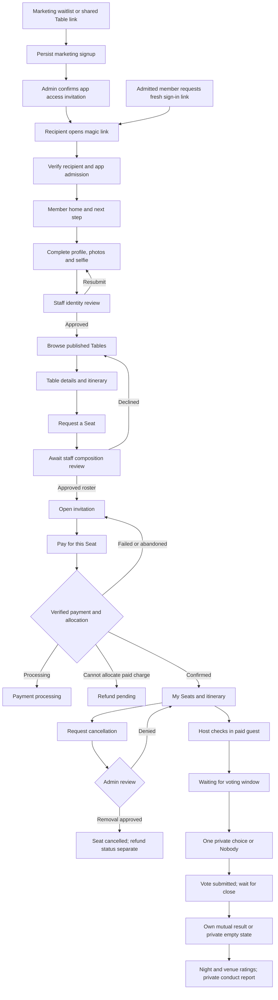

# Fifthwheel MVP — App Flow Map and UI Design Brief

Version 3 · 2026-11-11 · Required experience for the product app. [PRD](PRD.md) owns policy; [Architecture](architecture.md) owns contracts; [Backlog](tasks-checklist.md) maps acceptance.

## 1. Experience structure

Create fresh member, admin, assigned-host and restaurant workspaces. Preserve the previous app’s visual styling while allowing UI layouts, information architecture and navigation to improve. The route coverage below is required; grouping/navigation may be refined without dropping capabilities or breaking external links. A guest always sees the actual next action: complete profile, await identity review, request Seat, await composition approval, pay, attend, vote or view result. The app never equates request, invitation, checkout hold and paid Seat.

Match the archived app’s visual style, not just its general mood: deep brown, ivory, restrained gold, Fraunces headings, Inter body. Consolidate source tokens into CSS variables; no decorative phone frame, screen-jump navigation, selectable demo result or applicant/admin mode toggle in production. Staff with multiple roles switch workspaces through authorized navigation.

## 2. Primary flow

Window and eligibility are server-enforced; the diagram does not imply that navigating forward makes a guest eligible. Pending cancellation retains the Seat until admin confirms removal. Guests arriving after voting opens can attend but are not added to the frozen ballot.

## 3. Routes and navigation contract

Dynamic route file names use TanStack `$tableId`/`$seatId`, not Next.js conventions. UUID params resolved server-side; a reference is not authorization. Preserve externally used `/staff`, `/terms`, `/privacy` and the signed webhook URL through fresh implementations or safe compatibility routes; do not assume old route files remain. New URLs below are the hand-off path contract; generate route tree through tooling.

| URL | Purpose, visible objects and primary action | Return/recovery |
| --- | --- | --- |
| `/` | Signed-out app access explanation or admitted member’s actual next step/upcoming Table | Shared Table destination retained through onboarding using validated internal return path |
| `/sign-in` | Admitted member requests a fresh verified-email magic link; no self-admission | Expired/used link → send fresh link; no arbitrary external redirects |
| `/waitlist` | Link/redirect to the existing marketing waitlist; no competing intake | Honest waiting state; no app admission, payment or reservation claim |
| `/auth/callback` | Verify the magic-link recipient/session and app admission, then activate once | Used/expired/malformed/wrong-owner links recover through sign-in/help; validated internal destination only |
| `/api/waitlist` | Existing marketing JSON intake endpoint, not a user navigation page | Persist/dedupe/validate safely; all valid, duplicate and honeypot outcomes share neutral 2xx semantics/copy, with no admission or email-delivery claim |
| `/account/profile` | Own profile, matching preferences, photos/selfie, identity status | Save draft; submit review; request correction; retry upload without losing fields |
| `/tables` | Published future Tables, date/neighborhood filters | Approved-profile gate; filter search params persist on back |
| `/tables/$tableId` | Public itinerary/date/neighborhood/price; own request/offer summary | Share URL copies normal link; withdraw request or Pay only when eligible |
| `/account/requests` | Own pending/declined/withdrawn requests and active invitations | Revisit Table; view safe decision; reapply if accepting |
| `/invitations/$token` | Table invitation locator, owner check, Table summary | Sign in → named offer; invalid/other-owner neutral inaccessible state; never an expiry countdown |
| `/tables/$tableId/checkout` | Named offer, price, terms and temporary payment hold | Abandon releases checkout allocation; offer stays open |
| `/checkout/return` | Durable result for own attempt | Confirmed → My Seat; pending → refresh/status; cannot allocate → refund status/support |
| `/account/seats` | Upcoming/past Seats and payment/refund states | Stable links; no sample “Jordan” identity |
| `/account/seats/$seatId` | Itinerary, calendar export, cancellation request and refund receipt/status | Request cancellation opens confirmation; preserves Seat until decision |
| `/tables/$tableId/tonight` | Paid guest's itinerary, attendance status, voting countdown/state | Late arrival/help; no guest toggle that authorizes attendance |
| `/tables/$tableId/vote` | Eligible first names, one choice or Nobody, submit confirmation | Before/after closed states; submitted immutable ballot receipt |
| `/tables/$tableId/reveal` | Own mutual first name or private empty result after close | No tallies, photos, contacts, chat CTA or one-sided state |
| `/tables/$tableId/recap` | Overall/venue ratings; separate conduct-report entry | Save/update rating; report receipt; retention-expired reveal has distinct unavailable state |
| `/staff` | Staff sign-in / role workspace entry | No role → no-access/help, no console records |
| `/staff/tables`, `/staff/tables/$tableId` | Supply calendar, draft editor, synchronization/conflicts, roster, paid count, T−24 decision | Admin publish/approve/proceed/cancel; host proposes and checks in assigned Table |
| `/staff/identity` | Current private photo submission review | Admin approve/resubmit; stale version warning; reviewed queue updates |
| `/staff/requests`, `/staff/waitlist` | Waitlist intake/app-access status, app invitation preview/confirm/send/resend, applicants, eligibility, roster proposals and replacement suggestion | Missing profile listed as incomplete, never invented matching data |
| `/staff/cancellations`, `/staff/refunds` | Cancellation review and refund obligations | Admin confirm removal/deny, cents/reason, independent refund pending/failed/succeeded state |
| `/staff/communications`, `/staff/email` | Preview authorized recipients/templates and delivery attempts | Confirm send; delivery-only retry; no repeat business operation |
| `/staff/audit`, `/staff/reports` | Redacted outcomes or restricted conduct triage | Admin only; report bodies excluded from general audit/search |
| `/restaurant` | Venue-scoped service list and Table details | Multi-venue user chooses only assigned venue; counts/times/host business contact, no guest records |

A shared link may show a minimal public Table preview before sign-in (title/date/neighborhood/price only). An uninvited visitor follows marketing signup and admin admission, preserving the destination. An admitted incomplete member completes onboarding; full booking navigation and Seat requests follow the approved-profile gate. Unpublished, unknown and unauthorized IDs return a neutral unavailable page without exposing private existence.

## 4. Required page anatomy and copy

### Admission, sign-in and home

Signed-out entry explains invitation-only app access and links to member sign-in plus the marketing waitlist. Returning sign-in sends a link only for an admitted member and uses neutral public feedback. Recovery is visible for expired/used links, provider error and wrong account. No password/sign-up path or public role toggle is introduced.

Admin waitlist list/detail shows signup name/email/date/source/neighborhood, exact submitted preferences where needed and waiting/sending/invited/failed/unknown/activated app-access states. Search/filter and pagination retain state. Send app invitation confirmation names the recipient and previews the email. Resend/retry preserves attempt history and clearly distinguishes provider-accepted from delivered/activated. An app invitation never includes a price or promises a Seat.

Member home prioritizes complete profile → identity review/resubmission → browse/request → Table invitation/payment → upcoming Seat/night → result/feedback. No-Table and no-request states remain useful, with a real next action or clear explanation. Account, requests and Seats are reachable without role/sample screen selectors. Proposed navigation and representative member/admin screens must be reviewed against both task usability and the archived styling before feature pages proliferate.

### Profile and manual review

Use named sections for basics, DOB and age preferences, identity/open-to, profile photo and selfie. DOB eligibility is age 21+ with no upper age limit; matching-age preferences are whole years from 21 through 120 inclusive. Own identity is a single Woman / Man / Non-binary choice. Open-to preference uses independent Women, Men and Non-binary people checkboxes, matching the marketing form and preserving every selected combination. No inferred/default broadened preferences. Explain why each sensitive item is needed and who sees it. Mark phone, one-liner and lifestyle/personality preferences optional. Separate “Saved” from “Submitted for review” and “Approved.” Do not show a phone verified badge or imply a government-ID check. Critical field edits explain renewed review before submit.

Primary CTA is Save and submit for review; pending state says “Your profile is awaiting staff review.” Resubmission says which correction is needed without sharing internal incident notes. Profile editing preserves valid fields when file upload fails. Approved unchanged versions stay approved when temporary review images are deleted after retention; explain that reupload is needed only for a new critical-fact review, not every later payment.

### Table, request, approval and invitation

Table page hierarchy: date/neighborhood → title → itinerary → $25 Seat price → own application/offer → next action. Avoid “Claim last seat” before review. Request CTA: “Request a Seat”; pending: “Request received — awaiting review.” Invitation CTA: “Pay for this Seat.” State clearly that only successful payment confirms a Seat, and temporary checkout availability can change.

Staff Table review separates proposed roster, approval status, invitations, paid Seats and actual attendance. Show hard-rule errors and stale revision conflicts next to Approve. Approval confirmation names recipients and says invitations will be sent. Queued delivery is “Sending,” not “Sent.” Supply conflicts have their own panel and cannot overwrite runtime state.

### Checkout and My Seats

Show $25 USD total, applicable terms/privacy versions and staff-review cancellation policy before opening Stripe. State: “Cancellation requests are reviewed by staff. A refund is not automatic.” Record consent atomically with checkout attempt. Terms/legal policy copy must match this policy at release; current automatic-tier copy cannot survive in receipts or emails.

Checkout countdown refers only to the 30-minute temporary hold. Expiry says “Checkout hold ended. Your invitation remains open.” Paid result is server-derived. Use “Confirming payment,” “Seat confirmed,” or “Payment received — refund pending” as separate outcomes. Pending money state never offers a blind second payment.

My Seat contains date/itinerary, calendar export, status, cancellation request and support. Cancellation confirmation says “Your Seat stays confirmed until staff review.” Show removal and refund separately; failed refund offers support/status, not a second cancellation action. Staff decisions display amount and remaining refundable balance; changing requested amount needs confirmation.

### Operations and night of

T−48 notice lists invitations without confirmed Seats. T−24 panel states paid count, composition validation, required decision and elapsed review time. Under three: Cancel is the only valid decision; nothing auto-cancels. Three to five valid paid guests: Proceed or Cancel. A later removal can suspend proceed and makes the unresolved state visible to staff and affected guests.

Host roster shows paid/check-in status and check-in action. Guests see their own status and itinerary, not other guests' preferences or DOB. Before voting: “Voting opens at [local time].” At opening: list frozen eligible first names, one selection or Nobody. Confirm text: “Submit your private choice? You won't be able to change it.” Submitted state reveals neither the choice counts nor other submissions. At close: own mutual first name or “No mutual connection this time.” No alternate demo outcomes. Results read from durable own-only finalized records; after retention expiry or applicable account removal show results unavailable rather than inventing a new match or contact path.

### Ratings and conduct reports

Overall 1–5 required, per-stop ratings/note optional. Conduct entry is separate and private; receipt states it was received and is reviewed by staff, without promising immediate monitoring. Admin triage page is separate from general feedback and venue aggregates. No chat, contact-sharing CTA or public conduct content.

## 5. UI system, accessibility and responsive acceptance

Visual source of truth: `archives/app-2026-11-11-before-restart/src/prototype/FifthWheelPrototype.tsx` (tokens and component recipes), with archived branded CSS and available assets as supporting evidence. Generic light/slate library defaults do not override this source. Inventory actual buttons, cards, forms, tabs, badges, dialogs, typography and spacing before defining shared components. Examples to preserve include the warm hairline `#3A2F20`, gold primary buttons with approximately 14px corners, surface cards with approximately 18px corners, Fraunces headings and Inter text. These are evidence of the previous style, not permission to copy non-working interactions, old refund promises or demo labels.

UI layouts, IA, menu labels/grouping and navigation may improve for clarity and task completion. Apply the shared visual language consistently to new admin and member flows. Capture representative old/new comparisons at matching phone/desktop sizes; record justified accessibility corrections. Broader restyling requires a human decision. Palette-only similarity is insufficient. No new visual theme/rebrand is part of the rewrite.

Use semantic shared components: page header, status badge, Table card, itinerary list, field/error summary, review queue, roster list, action confirmation dialog, async result banner, pagination and empty/error panel. Use accessible existing Radix/shadcn primitives where suitable. Centralize tokens: background `#161009`, surface `#211A11`, raised `#2B2216`, ivory `#F3E9D8`, gold `#C79A4B`, wine `#7C3547`, sage `#7C9070`; adjust text/status shades to meet contrast rather than treating prototype colors as immutable.

Guest phone: one-column, readable itinerary, 44px primary controls, full-width action and visible pending states. Desktop: readable max-width forms and multi-column Table collection. Staff desktop: list/detail panes with persistent Table context; phone: stacked list → detail with return state. Partner console uses task-fit width, not a phone mock frame. No clipped actions at 320 CSS px, 200% text zoom or long names/messages.

Target WCAG 2.2 AA. Dialogs trap/return focus and label consequences; alerts announce errors/status without exposing private results; radio group for ballot choice includes Nobody and clear keyboard interaction; forms identify labels/errors and preserve values. Focus remains visible; status always has text/icon as well as color. Non-essential animation respects reduced motion. Keep normal text ≥4.5:1 and large text/UI boundaries ≥3:1. Verification includes keyboard-only flow, screen-reader checks, touch, reflow and text expansion.

## 6. State matrix and recovery

| Family | Empty/loading | Error/permission | Pending/destructive/replay | Scale/recovery |
| --- | --- | --- | --- | --- |
| Profile/review | Blank own form; upload progress; pending queue | Preserve values; owner/admin only images | Resubmit critical edits; no duplicate submission | Queue pagination; signed URL refresh |
| Browse/request | No Tables/filters; skeletons | Last-good supply or retry; unpublished inaccessible | Requested≠invited≠paid; duplicate request reuses record | Cursor pagination; URL filter return |
| Invitation/checkout | Offer loading; no active offer | Wrong owner denied; stale/revoked offer | Countdown for checkout only; payment unknown reconciles before retry | Resume via account/attempt ID, never raw client paid flag |
| Cancellation/refund | No requests; waiting staff decision | Owner/admin; provider failure retains obligation | Confirm removal/amount; retries same operation | Separate status filters and exception queue |
| Staff/sync | Empty work queue; staged import | Partial sync keeps old snapshot; conflict panel | Preview before publish/clone/send/cancel; safe undo drafts only | Pagination, revision checks, durable notices |
| Night/vote/reveal | No eligible attendees; wait/closed/result | Ineligible route neutral; ballots private | Immutable submit; late submit rejected; removed match unavailable | Server time and frozen eligibility; no fake countdown authority |
| Recap/report/partner | No feedback/assigned venue | Reporter/admin only report; venue-scope deny | Rating upsert and report receipt | Aggregate minimum three; no free-text leaks |

Every route must reach completion or a named retry/account/support path. Loading never substitutes demo data. Direct links and browser navigation do not bypass profile, offer, role, payment, attendance or time gates. Acceptance is A01–A35 in the PRD.
